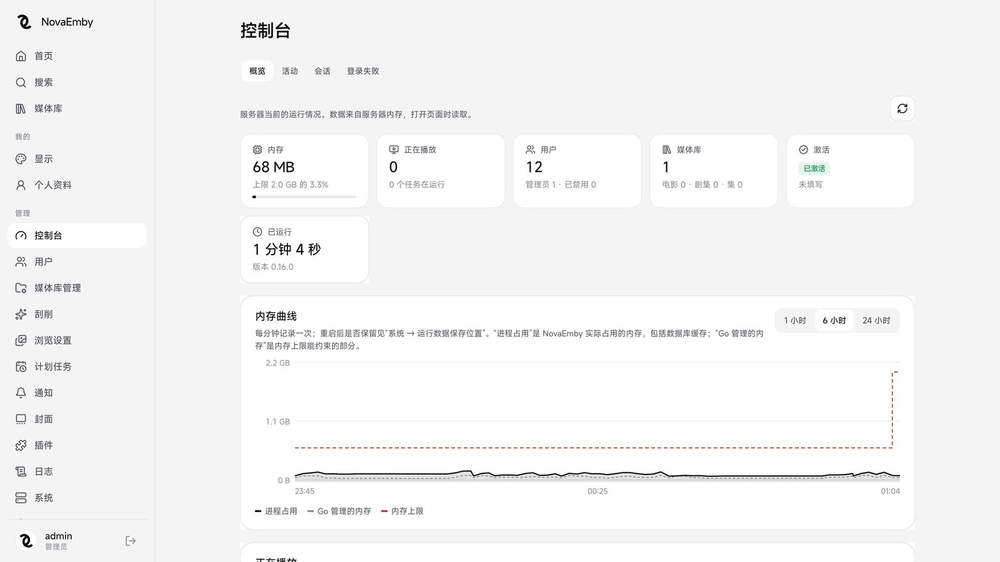
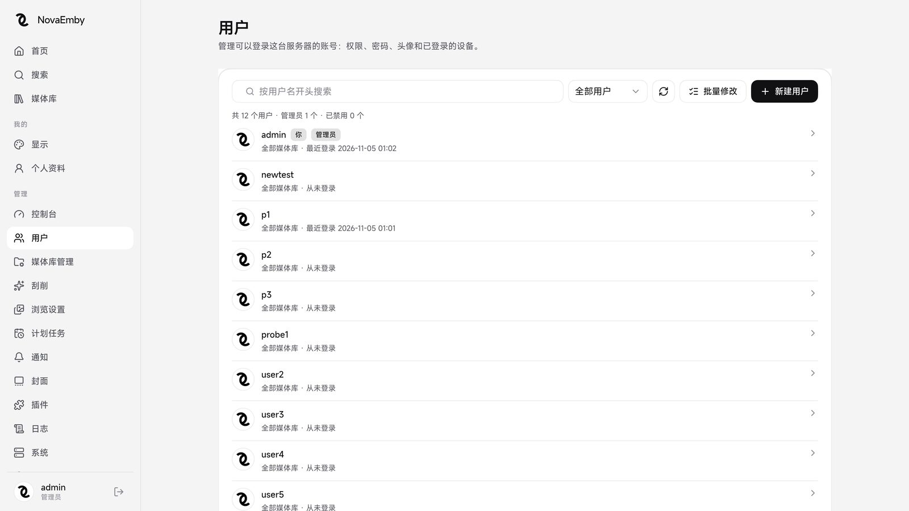
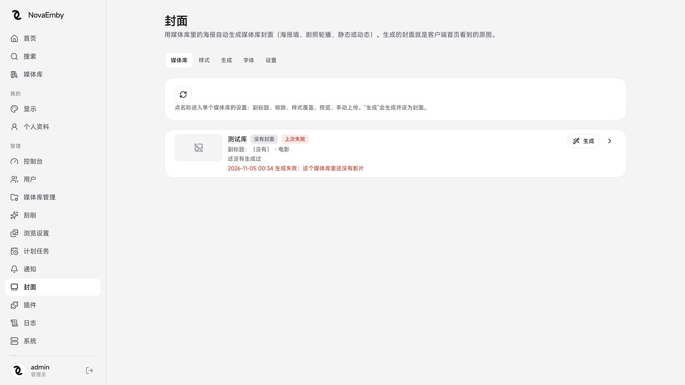
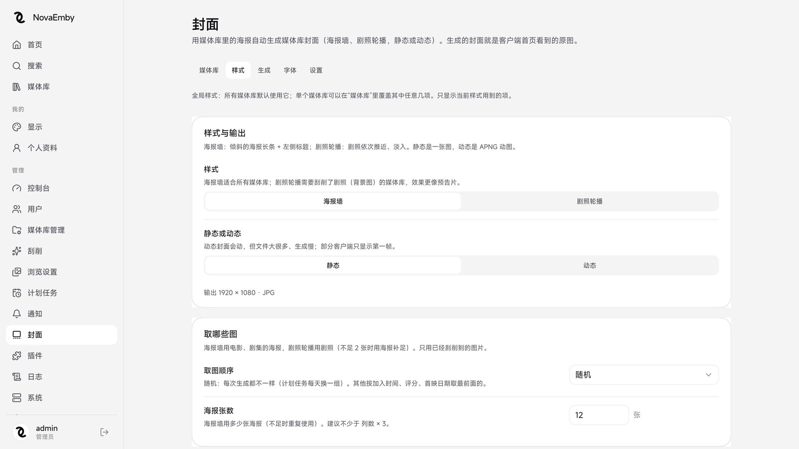
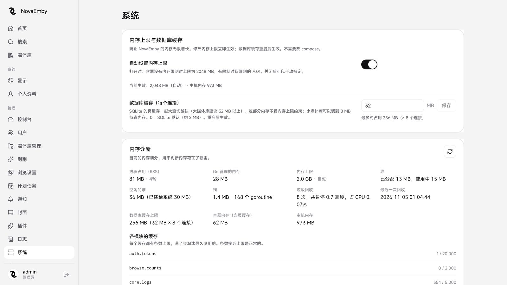

# Nove Media Kit

开箱即用的媒体服务端部署包，基于开源项目构建，提供 Docker 镜像与完整部署说明。

> 面向个人 NAS / 小服务器：直接读取已有媒体库（NFO、海报、演员头像原样复用），
> 无需重新刮削。Infuse、SenPlayer、VidHub、Emby 官方客户端均可直接连接。

---

## 界面预览

### 控制台

实时查看内存占用、在线用户、媒体库规模、激活状态与内存曲线。



### 用户管理

创建和管理账号，独立设置权限、媒体库访问、播放与下载开关。



### 封面

用媒体库里的海报自动生成库封面，支持海报墙与剧照轮播两种风格。



样式可调项：海报数量、倾角、列数、缩放、字体、背景、静态或 APNG 动图。



### 系统与内存诊断

内存上限自动跟随容器限制（无限制时 2048 MB），数据库缓存、各模块缓存条数一目了然。



---

## 功能一览

### 用户管理

- **不限用户数量**，可创建任意多个账号
- 每个用户独立设置：可访问的媒体库、能否播放、能否下载、同时播放路数、删除权限
- 批量修改权限：选中本页或「匹配的全部用户」，一次改完
- 设备管理：查看每个用户在哪些客户端登录，单个或全部踢下线
- 密码使用 argon2id 存储，登录失败按 IP 限速并记录
- 无公开注册入口，只有管理员能建号
- 支持邀请码注册（可选开关）

### 海报与封面

- **媒体库封面一键生成**：内置封面生成器，用库里的海报做出首页封面
- 两种风格：
  - **海报墙** — 倾斜排列的海报条，标题在左侧；背景可取模糊 / 毛玻璃 / 纯色 / 渐变
  - **剧照轮播** — 剧照推近、淡入、故障效果轮流切换
- 输出格式：JPG / PNG / WebP 静态图，或 APNG 动图
- 可调参数：海报数量、倾角、列数、缩放、标题字体、副标题、文字阴影、背景色
- 每个媒体库可单独覆盖任意样式项，也可用全局样式
- 手动上传封面不会被批量生成覆盖
- 字体管理：内置思源黑体，其余字体按需下载并校验 sha256
- 生成任务支持并发、进度显示、日志查看
- 可设置计划任务定时刷新封面（如每天换一组）

### 媒体库

- **只读模式**：只读取已有的 NFO、图片和媒体信息文件，不联网、不写入，不破坏原版 Emby 的元数据
- **正常模式**：自动刮削，字段优先级 `锁定 > NFO > 在线来源 > 文件名`
- 扫描只发现文件的增删改，大库也不慢
- 扫描性能可调：计算线程、同时扫描的库数、每个库同时读取的目录数
- 扫库通知：兼容 Emby 的扫库接口，带延时合并与路径映射，MoviePilot 等工具整理完通知一声即可
- **删除保护**：网盘掉线导致一次扫描要删掉大半个库时自动放弃
- 多版本：同一部片的多个版本可按码率排序，客户端里选择播放
- 跨媒体库合并：TMDB ID 相同的电影/剧集合并成一个条目

### 播放

- **不做转码**：本地文件直放，支持拖动进度
- `.strm` 只做 302 跳转，服务器不中转视频流量
- 百人同播不卡，带宽压力在源站
- 兼容前置 302 软件：媒体源路径、协议字段与原版一致
- 多线路：同一台服务器的电信、移动、外网地址，支持的客户端可一键切换
- 记录播放进度、已看标记、收藏，副本间同步

### 刮削与元数据

- 自定义 TMDB Key 与接口地址（可填反代）
- 每个媒体库单独设置元数据和海报语言，可优先无文字海报
- 豆瓣慢速同步：后台按时段带抖动地补中文标题、简介和评分，被封控自动退避
- MDBList 补烂番茄评分
- ffprobe 读取媒体信息，支持 ISO、ts、蓝光目录
- 演员头像：直接读取原版 Emby 的人物图片目录，只读模式也能联网补头像
- 片头片尾识别：手动 > 剧集固定时长 > 已有标记 > 章节名 > 在线片头库 > 音频指纹
- 性能可控：同时刮削数、ffprobe 并发、`.strm` 单独限速、外部进程可绑核并降优先级

### 通知与自动化

- **Telegram 通知**：24 类通知逐项开关，新片入库带海报汇总，免打扰时段只保留安全与系统类
- **Telegram 管理命令**：`/status` `/playing` `/libraries` `/tasks` `/search` `/users`，
  只响应白名单私聊，危险操作二次确认
- **Webhook**：载荷与 Emby 4.8 一致，JSON 或表单，失败自动重试
- **计划任务**：扫描、刷新元数据、豆瓣同步、片头片尾识别、数据库优化、封面、备份，
  触发器与 Emby 相同并可限定运行时段

### 插件

- 插件商店，官方仓库用 ed25519 签名
- 自建仓库：用 GitHub 模板仓库写插件，Actions 自动编译打包发布清单
- 插件以 nobody 身份独立运行，有内存上限，崩溃自动重启，不拖垮服务端
- 安装未签名插件、上传插件包前会醒目提示风险

### 系统与运维

- **内存上限**：默认自动（无容器限制时 2 GB，有限制取 70%），网页里随时改，立即生效
- **内存诊断**：进程占用、Go 堆、数据库缓存、各模块缓存条数一目了然，可导出分析
- **请求频率控制**：按用户和按 IP 的令牌桶，分登录、浏览、图片、播放控制等 7 类
- **备份与还原**：在线快照数据库、配置、头像、封面、插件，计划任务自动备份
- **日志**：全局和每个模块单独设级别，网页实时查看、筛选、高亮、下载
- **API 密钥**：管理员可创建，MoviePilot、Telegram 机器人等按 Emby 的方式调用
- **CPU 可控**：扫描、刮削、ffprobe / ffmpeg 分别限制线程与核心，截图可用核显硬解

### 客户端兼容

- Emby 官方客户端（iOS / Android / TV / Web）
- Infuse（iOS / tvOS / macOS）
- SenPlayer、VidHub、Fileball 等第三方客户端
- 支持 Emby API，兼容现有 Emby 生态工具

---

## 快速开始

### Docker Compose（推荐）

```yaml
services:
  nove:
    image: imjix/nove-media-kit:latest
    container_name: nove
    restart: unless-stopped
    network_mode: host
    environment:
      - TZ=Asia/Shanghai
      - NOVA_SERVER_ADDR=:8098
    volumes:
      - ./config:/config      # 数据库、日志、插件、封面，必须持久化
      - ./media:/media        # 媒体目录，可加 :ro 只读
      # - /CloudNAS:/CloudNAS:rslave   # CD2 挂载时用
      # - /var/lib/emby/metadata/people:/emby-people:ro  # 复用 Emby 演员头像
```

```bash
docker compose up -d
```

### Docker Run

```bash
mkdir -p ./config ./media

docker run -d \
  --name nove \
  --restart unless-stopped \
  --network host \
  -e TZ=Asia/Shanghai \
  -e NOVA_SERVER_ADDR=:8098 \
  -v "$PWD/config:/config" \
  -v "$PWD/media:/media" \
  imjix/nove-media-kit:latest
```

### 首次访问

浏览器打开 `http://服务器IP:8098`，用日志中的 6 位初始化码创建管理员：

```bash
docker logs nove 2>&1 | grep -i "setup_code"
```

---

## 配置说明

| 环境变量 | 说明 | 默认 |
|---|---|---|
| `NOVA_SERVER_ADDR` | 监听地址 | `:8096` |
| `NOVA_PATHS_CONFIG` | 配置目录 | `/config` |
| `NOVA_MEMORY_LIMIT_MB` | 内存软上限（MB），不设则取容器限制的 70% | 自动 |
| `NOVA_LOG_LEVEL` | 日志级别：`info` / `debug` / `trace` | `info` |
| `NOVA_DB_CACHE_SIZE_MB` | SQLite 缓存，大库建议 32 以上 | SQLite 默认 |
| `TZ` | 时区 | `UTC` |

### 目录结构

```
/config
├── novaemby.db      数据库（用户、媒体库、播放记录）
├── logs/            日志文件
├── plugins/         插件
├── covers/          生成的封面
├── fonts/           字体
└── backups/         备份
```

**`/config` 一定要持久化**，否则重建容器会丢配置。

---

## 资源占用参考

| 场景 | 内存 | 说明 |
|---|---|---|
| 空载（无扫描） | ~90 MB | 最小占用 |
| 常规使用 | 150–300 MB | 有媒体库、少量播放 |
| 扫描中 | +100–200 MB | 扫描完成后回落 |
| 封面生成 | +50–150 MB | 视并发生成数而定 |

1 核 1G 足够个人使用（实测空载 90 MB）。**不建议在 1G 机器上同时跑扫描和转码。**

---

## 常见配置示例

### 复用已有 Emby 的媒体库（只读）

```yaml
volumes:
  - ./config:/config
  - /mnt/media:/media:ro                                # 只读，不动原文件
  - /var/lib/emby/metadata/people:/emby-people:ro       # 复用演员头像
```

新建媒体库时选「只读模式」，指向 `/media`，几分钟扫描完即可用。

### 配合 CD2 / 115 网盘

```yaml
volumes:
  - ./config:/config
  - /CloudNAS:/CloudNAS:rslave
environment:
  - NOVA_STRM_LOCAL_ROOTS=/CloudNAS
```

`.strm` 指向本地挂载路径时直接读取，指向网址时走 302 跳转。

### 核显硬解（截图用）

```yaml
devices:
  - /dev/dri:/dev/dri
```

仅用于截图，播放始终是直放不转码。

---

## 常用命令

```bash
# 查看日志
docker logs -f --tail 100 nove

# 重启
docker restart nove

# 升级镜像
docker compose pull && docker compose up -d

# 备份
tar czf nove-backup-$(date +%F).tar.gz ./config

# 进入容器
docker exec -it nove sh
```

---

## 故障排查

**容器起不来**
```bash
docker logs nove
```
常见原因：`/config` 无写权限、端口被占用（同机有 Emby 时换 8098）。

**网页打不开**
```bash
curl http://127.0.0.1:8098/health
```
返回 `{"status":"ok"}` 说明服务正常，检查防火墙 / 安全组。

**内存被吃光**
设置 `NOVA_MEMORY_LIMIT_MB=600`，并避免同时开启多个扫描任务。

**扫描很慢**
降低「同时扫描的媒体库」和「每个库同时读取的目录数」，网盘挂载尤其要注意限流。

**封面生成失败「这个媒体库里还没有影片」**
先扫描媒体库，有影片后才能生成封面。

---

## 镜像标签

| 标签 | 说明 |
|---|---|
| `latest` | 最新版 |
| `v2` | 固定版本 |

生产环境建议用固定版本，避免意外升级导致配置不兼容。

---

## 系统要求

- Linux（amd64 / arm64，双架构镜像）
- Docker 20.10+ 或 Podman
- 磁盘：镜像约 620 MB，配置目录视媒体库大小而定
- 建议 `restart: unless-stopped`（网页「重启」功能依赖它自动拉起）

---

## 免责声明

本项目仅供个人学习和自建媒体服务器使用。请勿用于商业分发或任何违反当地法律法规的用途。
使用者需自行承担因使用本软件产生的全部责任。镜像基于上游开源项目构建，使用前请自行确认符合其许可条款。
